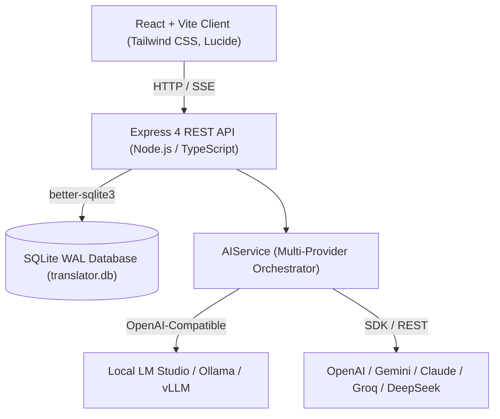
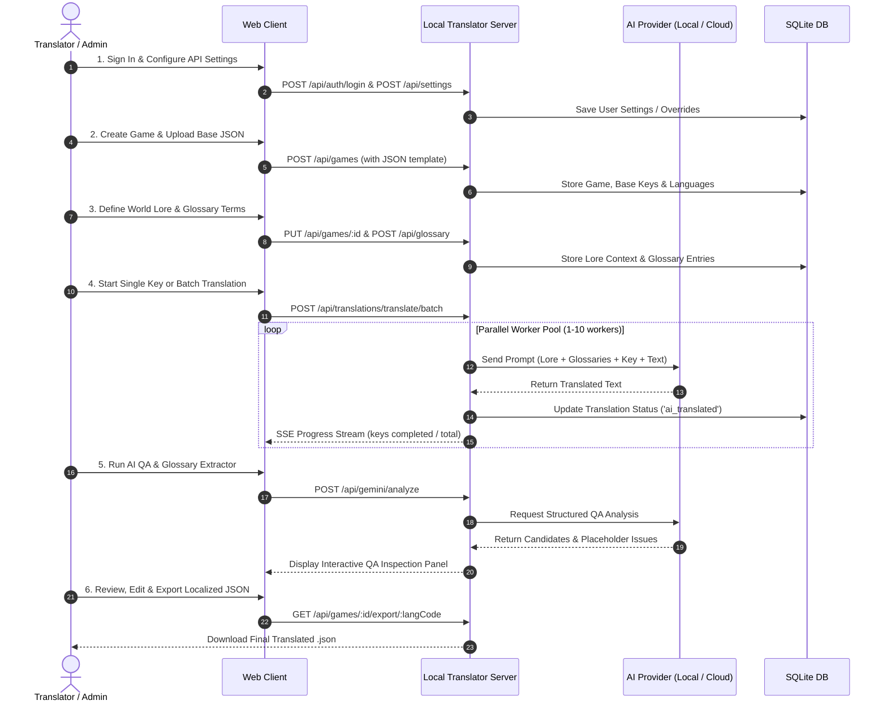

# 🎮 Local Game Translator: Complete Workflow & Feature Guide

A modern, full-stack video game localization suite built for game developers, translators, and localization teams. It combines **multi-provider AI translation**, **deep world-lore context injection**, **glossary consistency enforcement**, **AI quality auditing**, and **multi-user team management**.

---

## 📑 Table of Contents
1. [System Architecture Overview](#-system-architecture-overview)
2. [Key Features & Capabilities](#-key-features--capabilities)
3. [End-to-End Localization Workflow](#-end-to-end-localization-workflow)
4. [AI Provider Engine & User Settings](#-ai-provider-engine--user-settings)
5. [User Authentication & Team Roles](#-user-authentication--team-roles)
6. [Supported JSON Formats & Schema Mapping](#-supported-json-formats--schema-mapping)
7. [Deployment & Self-Hosting Guide (GCP VM / Docker)](#-deployment--self-hosting-guide-gcp-vm--docker)
8. [CLI Commands & Testing](#-cli-commands--testing)
9. [Project Directory Structure](#-project-directory-structure)

---

## 🏛️ System Architecture Overview



- **Frontend**: React 18 with Vite, Tailwind CSS, Lucide icons, and server-sent event (SSE) listeners for live batch translation progress.
- **Backend**: Express 4 running on Node.js + TypeScript (via `tsx`).
- **Database**: SQLite with `better-sqlite3`, WAL mode enabled for high-concurrency read/writes and cascade foreign keys.
- **AI Subsystem**: Decoupled multi-provider engine supporting local GPU endpoints and cloud APIs.

---

## 🚀 Key Features & Capabilities

### 1. 🤖 Multi-Provider AI Translation Engine
- **Decoupled Roles**: Configure independent AI models for **Translation** and **QA / Glossary Auditing**.
- **Universal Compatibility**:
  - **Local AI**: LM Studio (`localhost:1234/v1`), Ollama (`localhost:11434/v1`), vLLM, or self-hosted GPU endpoints.
  - **Cloud AI**: Google Gemini (`gemini-2.5-flash`, `gemini-3.7-flash`, `gemini-2.5-pro`), OpenAI (`gpt-4o`, `gpt-4o-mini`), Anthropic Claude (`claude-3-7-sonnet`, `claude-3-5-haiku`), Groq (`llama-3.3-70b-versatile`), and DeepSeek (`deepseek-chat`).
- **Live Provider Testing**: 1-click test button queries available models directly from the provider API.

### 2. 👤 User Authentication & Role-Based Access Control (RBAC)
- **Roles**:
  - `admin`: Manage team members, promote/demote roles, configure global system defaults, manage all projects.
  - `translator`: Translate keys, start batch queues, edit context & glossaries, run QA.
  - `viewer`: Read-only access to translations and project overviews.
- **Per-User AI Settings**: Each user can configure their own personal API keys, temperature, and model preferences with automatic fallback to server global defaults.
- **Dedicated Management View**: Top-level **Users & Team** page to monitor team metrics, create collaborators, and promote admins.

### 3. 📖 Big Context & World-Lore Engine
- Video game translations often sound robotic without context. The **Context Editor** lets you specify:
  - Game world lore, factions, magic systems, and historical backstory.
  - Character tone, speech mannerisms (e.g. archaic knight vs streetwise rogue).
  - General localization constraints (humor style, cultural adaptation rules).
- Context is automatically formatted and injected into prompt system instructions for every single translation request.

### 4. 📚 Smart Glossary & Terminology Enforcement
- Prevents inconsistency across tens of thousands of dialogue lines.
- Categorize terms into **Character**, **Item**, **Location**, **UI**, **Lore**, or **General**.
- Target-specific glossaries: customize terms per language code (e.g. Japanese character honorifics vs German equipment names).
- Injected directly into the translation prompt as hard constraints that the AI must follow.

### 5. ✨ AI Quality Assurance & Glossary Extractor (AI Inspector)
- Automated inspection tool powered by structured JSON output:
  - **Terminology Discovery**: Scans translated dialogue and identifies high-frequency proper nouns and terms to add to the official glossary.
  - **Broken Placeholders**: Flags corrupted variables like `{player}`, `{0}`, `%s`, or tags like `<color=red>`.
  - **Tone & Consistency Drift**: Alerts you when characters break tone or depart from established world lore.

### 6. ⚡ High-Throughput Batch Translation Queue
- Translate thousands of dialogue lines with live progress tracking.
- **Configurable Worker Pool**: Set concurrency from 1 worker (safe for local 8GB GPUs) up to 10 parallel workers (high-throughput cloud APIs).
- **Control**: Pause, resume, or cancel batch jobs at any time.
- **Filters**: Translate only untranslated keys or re-translate all keys with updated instructions.

### 7. 🗂️ Flexible JSON Schema Mapping & Export
- Supports both nested JSON objects and arrays of key/value objects.
- Interactive schema wizard allows mapping `id`, `text`, `context`, and `speaker` properties.
- 1-click export of complete localized JSON files retaining original indentation and structure.

---

## 🔄 End-to-End Localization Workflow



---

## ⚙️ AI Provider Engine & User Settings

### 1. Translation Engine vs QA Inspector
You can mix and match providers for cost and speed optimization:
- **Example 1 (Fully Local / Offline)**:
  - Translation: Local LM Studio with `translategemma-12b-it` or `qwen2.5-coder`.
  - QA Inspector: Local Ollama with `llama3.3:70b`.
- **Example 2 (Hybrid Cloud)**:
  - Translation: Groq (`llama-3.3-70b-versatile`) for ultra-fast, low-cost translation.
  - QA Inspector: Google Gemini (`gemini-2.5-flash`) for deep structured consistency auditing.

### 2. User Overrides vs Global Defaults
- **Admin**: Can switch the save scope between **My User Account** (personal) and **Server Global Defaults** (baseline for new users).
- **Translators**: Any setting modified in the settings dialog is saved to their user profile and automatically applied to their translation requests.

---

## 👥 User Authentication & Team Roles

| Role | Permissions |
| :--- | :--- |
| **`admin`** | Full access: User management, promoting admins, editing global system defaults, creating/deleting games, translating, QA inspection, and exporting. |
| **`translator`** | Game translation, batch translation queues, context & glossary editing, QA auditing, and file export. |
| **`viewer`** | Read-only access to project lists, translation tables, glossaries, and exported files. |

### Promoting an Admin via CLI:
```bash
npm run set-admin <username>
```
*Example:* `npm run set-admin whell2`

---

## 📦 Supported JSON Formats & Schema Mapping

### Format A: Flat & Nested Key-Value JSON
```json
{
  "menu": {
    "start_game": "Start Adventure",
    "options": "Settings",
    "dialogue": {
      "npc_intro": "Greetings, traveler! Welcome to Eldoria."
    }
  }
}
```

### Format B: Array of Objects
```json
[
  {
    "id": "quest_01_title",
    "text": "The Lost Relic of Solitude",
    "notes": "Spoken by Elder Varis in the temple"
  },
  {
    "id": "quest_01_desc",
    "text": "Retrieve the ancient crystal from the sunken ruins.",
    "notes": "Objective description"
  }
]
```
*The built-in Schema Wizard allows selecting the `ID Key Path` and `Text Key Path` upon game creation.*

---

## 🌐 Deployment & Self-Hosting Guide (GCP VM / Docker)

### Option 1: Docker Compose (Recommended for GCP Compute Engine)

1. **Clone the repository on your VM**:
   ```bash
   git clone https://github.com/your-username/LocalTranslator.git
   cd LocalTranslator
   ```

2. **Configure Environment Variables**:
   ```bash
   cp .env.example .env
   nano .env
   ```

3. **Launch the Container**:
   ```bash
   docker-compose up -d --build
   ```

4. **Promote Your Admin Account**:
   ```bash
   docker-compose exec localtranslator npm run set-admin <your_username>
   ```

### Option 2: Bare Metal / PM2 (Node.js 20+)

1. **Install Dependencies & Build Client**:
   ```bash
   npm install
   npm run build
   ```

2. **Run with PM2**:
   ```bash
   npm install -g pm2
   pm2 start server/server.ts --name "translator" --interpreter ./node_modules/.bin/tsx
   pm2 save
   pm2 startup
   ```

### GCP Firewall Setup
Ensure your GCP Compute Engine VM has firewall rules allowing TCP traffic on your application port (default `3001` or `80` if using a reverse proxy like Nginx).

---

## 🧪 CLI Commands & Testing

| Command | Description |
| :--- | :--- |
| `npm run dev` | Runs backend server (`tsx watch`) and frontend client (`vite`) concurrently. |
| `npm run build` | Compiles the production client bundle into `dist/client`. |
| `npm start` | Starts the production backend server on `HOST:PORT`. |
| `npm test` | Runs the Playwright E2E automated test suite. |
| `npm run set-admin <user>` | Promotes the given username to `admin` in SQLite. |

---

## 📂 Project Directory Structure

```text
LocalTranslator/
├── client/                     # React 18 + Vite Frontend
│   └── src/
│       ├── features/
│       │   ├── auth/           # LoginModal, UserMenu, UserManagementPage, AuthContext
│       │   ├── games/          # GameListCard, GameCreationModal, AppHeader, ContextEditor
│       │   ├── gemini_qa/      # GeminiInspectorPanel, IssueCard, CandidateCard
│       │   ├── glossary/       # GlossaryManager, GlossaryTable, AddTermModal
│       │   ├── settings/       # SettingsModal, ProviderConfigCard
│       │   └── translations/   # TranslationWorkspace, TranslationTable, BatchModal
│       ├── services/           # ApiClient, AuthApi
│       └── types/              # Client TypeScript Interfaces (< 300 LOC each)
├── server/                     # Express 4 + TypeScript Backend
│   ├── database/               # sqlite_client.ts, schema_definitions.ts
│   ├── features/
│   │   ├── ai_providers/       # gemini_provider, openai_provider, anthropic_provider, ai_service
│   │   ├── auth/               # auth_repository, auth_middleware, auth_router
│   │   ├── games/              # games_repository, games_router
│   │   ├── gemini/             # glossary_extractor, gemini_router
│   │   ├── glossary/           # glossary_repository, glossary_router
│   │   ├── lm_studio/          # translation_prompt_builder
│   │   ├── settings/           # settings_repository, settings_router
│   │   └── translations/       # batch_translation_queue, translations_router
│   ├── scripts/                # set_admin.ts
│   └── server.ts               # Express initialization & static asset server
├── data/                       # Persistent SQLite database (translator.db)
├── tests/                      # Playwright E2E Test Suite (translator_app.spec.ts)
├── Dockerfile                  # Multi-stage production container build
├── docker-compose.yml          # Container orchestration with volume persistence
└── package.json                # Project scripts and dependencies
```
